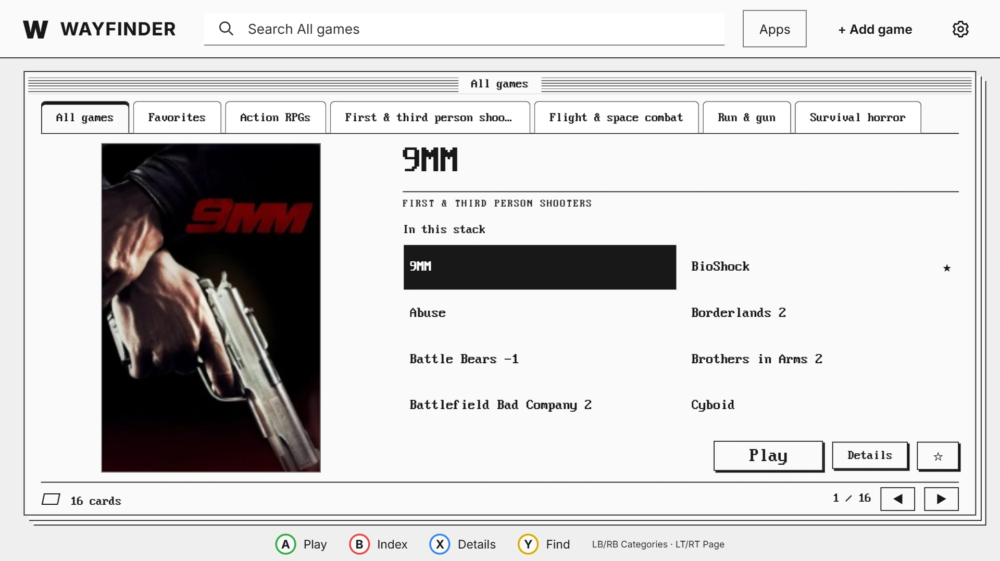

#  Wayfinder

Wayfinder puts the Android games you already own into a library you can browse with a controller or touchscreen. Open it when you want to play, or set it as your handheld’s home screen. Your categories, favorites, and portrait covers follow you when you switch layouts.

**For landscape Android devices running Android 8.0 or later.** [Download the beta APK](https://github.com/androidgyny/wayfinder/releases/tag/v0.9.257-beta.25) · [Browse the screenshot gallery](docs/GALLERY.md)



*On first launch, Hyperstack opens with an empty card catalogue. Here it is with games added.*

## Add your first game

1. Download the APK on your Android device and open it. If Android prompts you, allow installation from the app you used to open the download.
2. Open Wayfinder and choose **Add game**. Pick an installed game, keep or edit its title, and choose a category. Something as simple as *Puzzle games* is enough to get started.
3. Choose a cover. You can use an image from your device, look up artwork through Google Play, or search Google Images or SteamGridDB. Portrait images fit the library’s 2:3 frames.
4. Save the entry, select its cover or title, and press **A** to play. Press **X** to edit it later. Click the **right stick** to reach screen controls such as **Add game** and **Settings**.

Wayfinder also accepts shortcuts from apps that offer **Add to home screen**. To use Wayfinder whenever you press Home, open **Settings → System & help → Set as default launcher**.

## Choose how you browse

Open **Settings → Appearance** and preview a preset. A **layout** determines how you move through the library. A **preset** pairs a layout with choices such as type, color, artwork size, and backdrop. All 33 layouts use the collection you’ve already organized.

| If you like to… | Try |
| --- | --- |
| Scan a list of game names | **Hyperstack** on Palo Alto puts a title index beside the selected cover. **Field Notes** on Bath turns the list into a tabbed notebook. |
| Pick a category before picking a game | **Fresh Ink** on Chicago uses illustrated posters. **Dawn** on Taipei pairs line drawings with a portrait-cover grid adapted from Daijishō. |
| Browse by box art | **Now Playing** on Cannes lines up games in illuminated cinema cases. **Exposure** on Rochester arranges them on a light table. |


*Now Playing on Cannes. Move across the posters to choose a game, or use the bumpers to change category.*

## As your collection grows

- **Find a game.** Search by title, jump between categories, sort by last played, or mark favorites for a shorter list.
- **Tidy up in batches.** Rename, merge, or reorder categories and move several games together. Library info shows counts and entries that need attention.
- **Keep everyday apps handy.** Click the left stick to open Apps. Give apps their own sections, pin up to eight to the dock, and use an installed icon pack or your own images.
- **Personalize your handheld.** Preview a preset before keeping it, save your own combinations, or choose background audio and startup media in **Settings → Sound & startup**.

### Optional AI assistance

You can organize the library by hand. If you enable Gemini, **Suggest Category** helps with a single entry, **AI Sort** suggests placements in existing categories, and **AI Reorganize** proposes a new category scheme. You can review proposals before applying them and undo changes while Wayfinder remains open.

To enable it, enter your own key under **Settings → System & help → AI assistance**. Requests send titles, package names, and relevant category information to Gemini. Wayfinder encrypts the key on your device and excludes it from backups. [Get a Gemini API key](https://aistudio.google.com/apikey)

## Controller reference

These are the default controls. Navigation adapts to the active layout or menu.

| Control | Action |
|---|---|
| D-pad | Navigate |
| A | Select or launch |
| B | Go back |
| X | Edit the selected game |
| Y | Search |
| LB / RB | Previous / next category |
| LT / RT | Page up / page down |
| Left stick click | Open the app drawer |
| Right stick click | Enter or leave screen-control navigation |
| Select / Back button | Toggle favorite |
| Start | Open settings |

## Your library and backups

Your library and saved artwork stay on your device. You can browse them offline; finding new artwork online requires an internet connection.

Use **Settings → Library → Back up** to export your titles, categories, category order, custom covers, and app drawer preferences. **Restore** replaces the current library with the contents of a backup. A library backup does not include installed games or their save files.

App drawer preferences include names, pins and their order, section assignments, hidden-from-section choices, custom images, and individually selected pack icons. Icon packs themselves are not included; reinstall them separately. Missing pack icons fall back to the app's original icon. Overall appearance settings—including the global icon pack, layout, and theme—and custom background, music, font, and startup media are not included. Restoring a library leaves those device settings in place.

## Project status

Wayfinder is beta software, made with the help of GPT-6 Astra and tested on a Pimax Portal running Android 10. If something behaves unexpectedly, include the device, Android and Wayfinder versions, layout, controller, and steps to reproduce it. [Release notes](https://github.com/androidgyny/wayfinder/releases) · [Report an issue](https://github.com/androidgyny/wayfinder/issues)

## Credits

| Layout · preset | Design credit |
| --- | --- |
| **Taipei · Dawn** | The game-selection grid adapts **Daijishō’s game-grid layout** for portrait covers, carrying over its category heading, item count, compact footer, and controller hints. The centered category title, arrows, and line art draw on *TFT Black Next*, adapted for Daijishō by Jamesinorbit from Anthony Caccese’s EmulationStation theme. [Daijishō](https://github.com/TapiocaFox/Daijishou) · [TFT Black Next](https://daijishou.github.io/Gallery/wallpapers_pack#tft-black-next) |
| **Chicago · Fresh Ink** | Daijishō inspired the illustrated category browser. [Daijishō](https://github.com/TapiocaFox/Daijishou) |
| **Hong Kong · Cognate** | Anthony Caccese’s [Analogue OS Menu for ES-DE](https://github.com/anthonycaccese/analogue-os-menu-es-de). |
| **Bath · Field Notes** | Zoidburg’s original design, adapted for ES-DE by ant (Anthony Caccese). [Notepad Pocket](https://github.com/anthonycaccese/notepad-pocket-es-de) |
| **Milan · Homage** | Weestuarty’s [Homage for ES-DE](https://github.com/Weestuarty-es-de/homage-es-de). |

These are independent adaptations. The linked projects credit the original creators. Attribution does not imply affiliation or endorsement.

<details>
<summary><strong>Illustrations, icons &amp; interface art</strong></summary>

- **Taipei category scenes** combine original drawings with adaptations from two MIT-licensed icon sets. [Tabler Icons](https://github.com/tabler/tabler-icons) · [Tabler license](app/src/main/assets/www/taipei/licenses/Tabler-LICENSE.txt) · [Phosphor Icons](https://github.com/phosphor-icons/core) · [Phosphor license](app/src/main/assets/www/taipei/licenses/Phosphor-LICENSE.txt)
- **Apps section icons** come from Phosphor. [Phosphor Icons](https://phosphoricons.com/) · [MIT license](app/src/main/assets/www/LICENSE-Phosphor.txt)
- **Chicago’s posters** were generated for Wayfinder using OpenAI image generation, then reviewed and corrected for the layout. **Brussels** combines AI-generated comic scenery and a wordmark with an original illustrated header. [Comic scenery](app/src/main/assets/www/comic-scenes/README.md) · [Wordmark](app/src/main/assets/www/comic-wordmark.png) · [Illustrated header](app/src/main/assets/www/comic-header.svg)
- **Notebook materials** were created for Wayfinder. [Paper](app/src/main/assets/www/notebook-paper.svg) · [Wood](app/src/main/assets/www/notebook-wood.svg) · [Binding rings](app/src/main/assets/www/notebook-rings.svg) · [Tape](app/src/main/assets/www/notebook-tape.svg)
- **Frames and surfaces** created for Wayfinder include the gallery frame and plaster, rental-shelf wood, light-table styling, procedural Blades metalwork, and Tidal Waves backdrop. [Gallery frame](app/src/main/assets/www/gallery-frame.svg) · [Plaster](app/src/main/assets/www/gallery-plaster.svg) · [Rental-shelf wood](app/src/main/assets/www/rental-wood.svg) · [Tidal Waves](app/src/main/assets/www/backgrounds/tidal-waves.svg)

Game artwork belongs to its respective creators.

</details>

<details>
<summary><strong>Pixel-art backdrops</strong></summary>

Luis Zuno (ansimuz) created the pixel art adapted for Wayfinder’s animated backdrops. The *Sideview Sci-Fi* collection supplies both **Alien Environment** and **Another World**. [Artist’s portfolio](https://ansimuz.itch.io/) · [Bundled licenses and adaptation notes](app/src/main/assets/www/backgrounds/NOTICE.txt)

- [Mountain at Dusk](https://opengameart.org/content/mountain-at-dusk-background) · [Magical Road](https://opengameart.org/content/magical-road-pixel-art-environment) · [Urban Landscape](https://opengameart.org/content/urban-landscape)
- [Sideview Sci-Fi](https://opengameart.org/content/sideview-sci-fi-patreon-collection) · [Fort of Illusion](https://opengameart.org/content/fort-of-illusion) · [Underwater Diving](https://opengameart.org/content/underwater-diving-pack) · [Forest of Illusion](https://opengameart.org/content/sunnyland-forest-of-illusion)

</details>

<details>
<summary><strong>Music &amp; interface sounds</strong></summary>

| What you hear | Creator and source |
| --- | --- |
| Interface feedback | Kenney’s [Interface Sounds](https://kenney.nl/assets/interface-sounds) and Wayfinder’s original Soft Terminal sounds. |
| *Another August* | The Cynic Project (Alex Smith). [Track](https://opengameart.org/node/73989) · [Artist](https://cynicmusic.com/) |
| *Chiptune: Exploration* | Luis Zuno (ansimuz). The looping track is bundled unchanged. [Track](https://opengameart.org/content/chiptune-exploration) · [Artist](https://ansimuz.itch.io/) |

These audio assets are provided under CC0. Attribution details accompany the project assets.

</details>

<details>
<summary><strong>Typefaces &amp; font licenses</strong></summary>

Most bundled typefaces come from Google Fonts under the SIL Open Font License. Individual notices are included with the font files. [Google Fonts](https://github.com/google/fonts) · [Bundled font notices](app/src/main/assets/www/fonts/)

| Typeface | Use, source, and license |
| --- | --- |
| Doto, Caveat, Anton, Oswald | Dot-matrix titles in Sedona, notebook handwriting, bold packaging-style headlines, and condensed headings, respectively. SIL OFL 1.1. [Doto](https://github.com/google/fonts/tree/main/ofl/doto) · [Caveat](https://github.com/google/fonts/tree/main/ofl/caveat) · [Anton](https://github.com/google/fonts/tree/main/ofl/anton) · [Oswald](https://github.com/google/fonts/tree/main/ofl/oswald) |
| GamePocket | Analogue-inspired pixel lettering by mumchristmas, based on AbFarid. SIL OFL 1.1. [GamePocket](https://github.com/mumchristmas/GamePocket-font) |
| UnifrakturMaguntia and Libre Caslon Text | Newspaper masthead and serif lettering. SIL OFL 1.1. [UnifrakturMaguntia](https://github.com/google/fonts/tree/main/ofl/unifrakturmaguntia) · [Libre Caslon Text](https://github.com/google/fonts/tree/main/ofl/librecaslontext) |
| IBM VGA (PxPlus IBM VGA 8×16) | VileR’s font, distributed unmodified. [The Ultimate Oldschool PC Font Pack](https://int10h.org/oldschool-pc-fonts/) · [CC BY-SA 4.0](https://creativecommons.org/licenses/by-sa/4.0/) |
| Wine Tahoma Regular and Bold | From Wine, under LGPL 2.1 or later. [Upstream fonts](https://github.com/wine-mirror/wine/tree/master/fonts) · [Corresponding sources and notices](docs/font-sources/wine-tahoma/) |
| Go font family | Designed by Bigelow & Holmes. [Go fonts](https://go.dev/blog/go-fonts) · [Bundled BSD-style license](app/src/main/assets/www/fonts/go-LICENSE.txt) |

</details>

## Build from source

Open this folder in Android Studio with JDK 17 or later and Android SDK 35. Let Android Studio configure your local SDK path, then build a debug APK:

```sh
./gradlew assembleDebug
```

On Windows, use `gradlew.bat assembleDebug`. The APK is written to `app/build/outputs/apk/debug/`. Fresh installations start with an empty library.

The application ID is `com.androidgyny.wayfinder`. Local release builds currently use the debug signing configuration; use your own signing key for distribution. No signing keys are included in the repository.
