# Wayfinder screenshot gallery

[← Back to the README](../README.md)

Fourteen ways to browse a game collection, followed by a home for everyday apps. From paper notebooks and metallic consoles to classic desktops and colorful terminals, these views use the same library of portrait covers and categories.

All fifteen images were captured directly on a **Pimax Portal (Snapdragon 865), running Android 10 at 1920 × 1080**, with **Wayfinder v0.9.212 Beta 16**, on **October 24, 2026**. These are unretouched screenshots. Appearance combinations, temporary favorites, and the Copenhagen table were arranged for the gallery; the device’s saved library and appearance were preserved. Games and personal cover artwork are not bundled. Animated backdrops appear as still frames.

[Palo Alto](#palo-alto) · [Bath](#bath) · [Bellevue](#bellevue) · [Milan](#milan) · [Atlantis](#atlantis) · [Redmond](#redmond) · [San Francisco](#san-francisco) · [Durango](#durango) · [Kyoto](#kyoto) · [Copenhagen](#copenhagen) · [aBBotSford](#abbotsford) · [Cupertino](#cupertino) · [Prague](#prague) · [Venice](#venice)

[Beyond the game library: Apps](#beyond-the-game-library)

## Palo Alto

**Hyperstack** — the default for new installations: a crisp card catalogue with category tabs, a paged title index, and Tengami’s portrait artwork.

## Bath

**Field Notes** — warm paper, colored tabs, handwritten headings, and KAMI held in place with a strip of tape.

## Bellevue

**Blades** — curved metallic category panels frame a compact title list and Across Age 2’s cover.

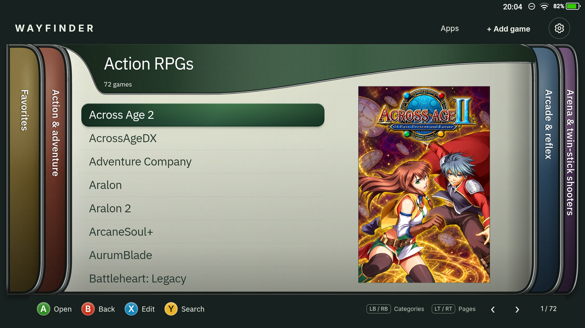

## Milan

**Homage** — bold orange graphics, oversized lettering, and a numbered title index give Sonic Mania Plus a packaging-inspired presentation.

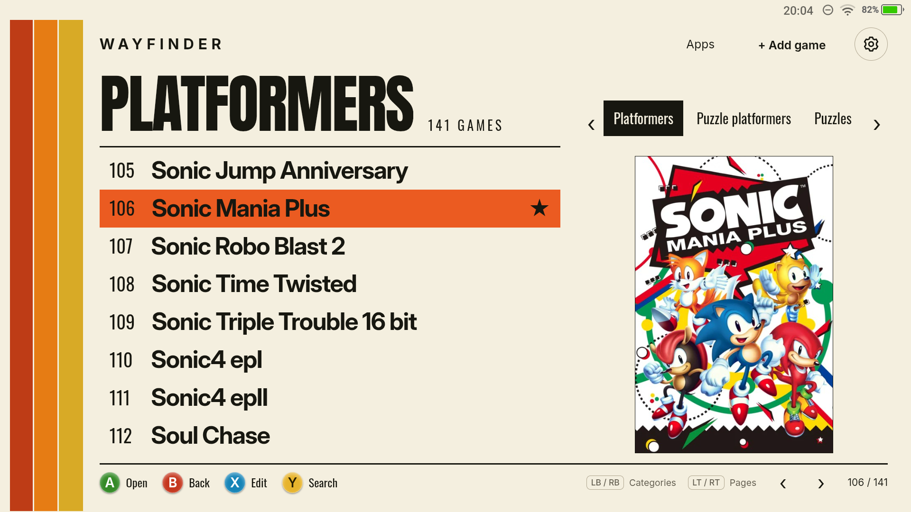

## Atlantis

**Droplet** — cool blue desktop styling, colorful folders, and a large preview of Night in the Woods.

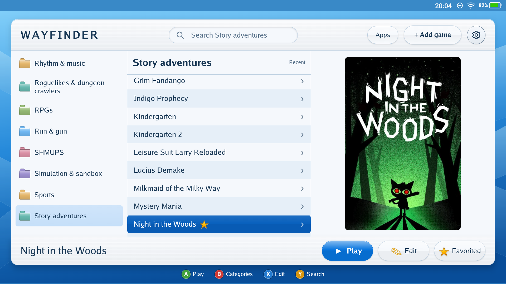

## Redmond

**Experience** — a familiar blue desktop, a file-browser title list, and Braid’s artwork and launch details.

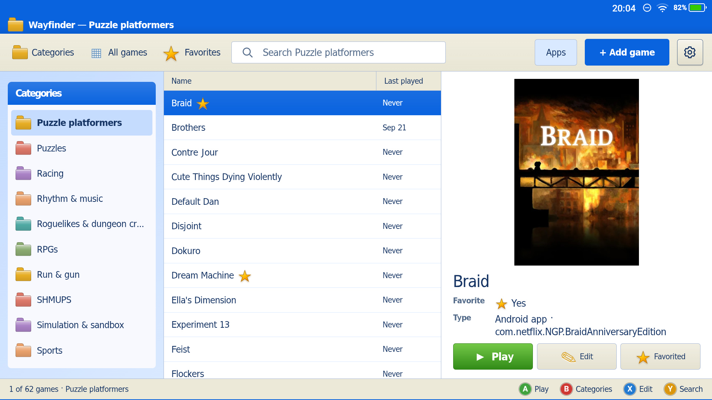

## San Francisco

**Final Frontier** — peach, lavender, and gold control panels surround a sci-fi library and Space Expedition.

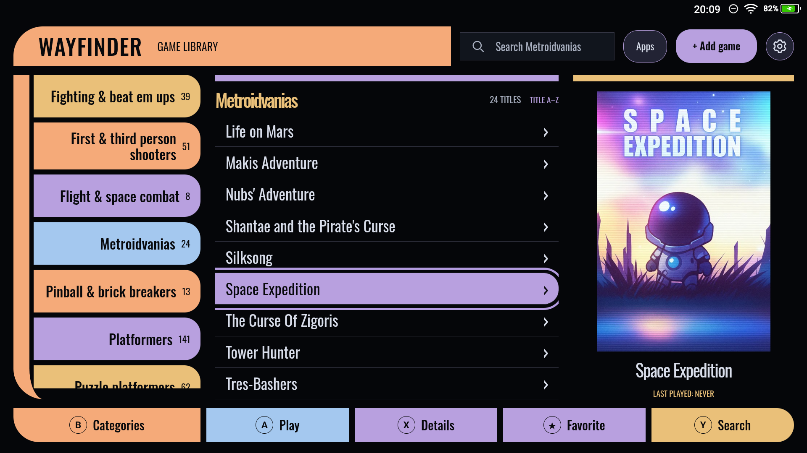

## Durango

**Boxer** — a recent-games sidebar beside a generous cover grid, in deep Evergreen colors.

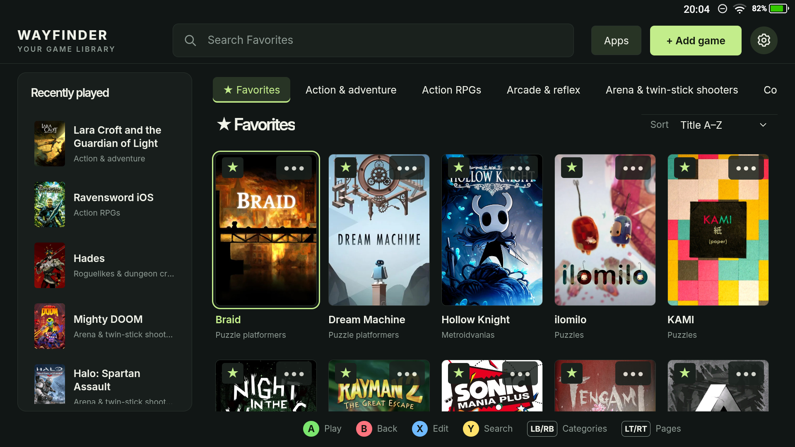

## Kyoto

**Smitchish** — a bright cover shelf, cyan selection glow, soft shadows, and a floating dock of colorful controller hints.

## Copenhagen

**Full House** — twelve covers on a green card table. Keep a pick, replace it, or shuffle to rediscover something.

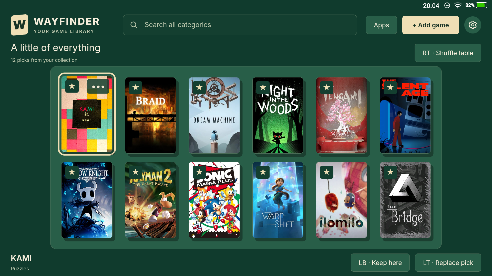

## aBBotSford

**MyNameIsMUD** — ANSI colors, IBM VGA lettering, and character-drawn windows. Open a title’s details to see its cover.

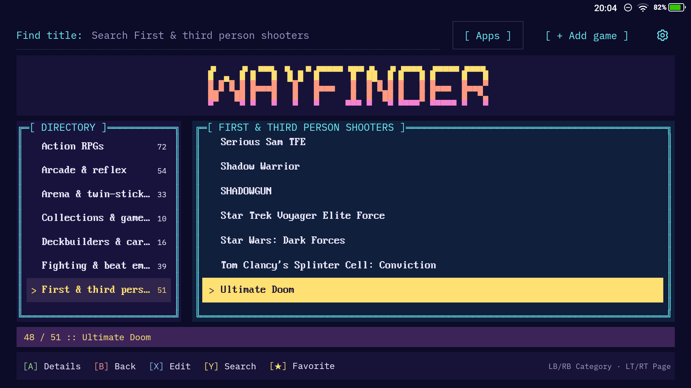

## Cupertino

**Midnight favorites** — a custom combination of Cupertino, Midnight colors, and artwork glow, with angled covers and reflections.

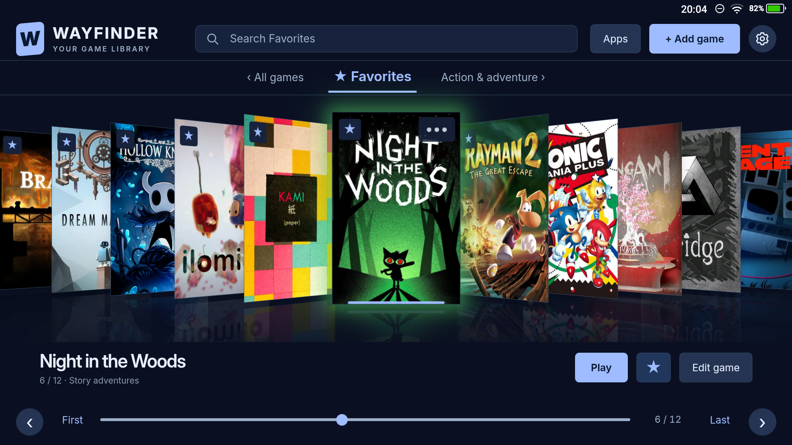

## Prague

**Cross Reference** — calm Sea Glass colors and parallel category columns for browsing several parts of a collection at once.

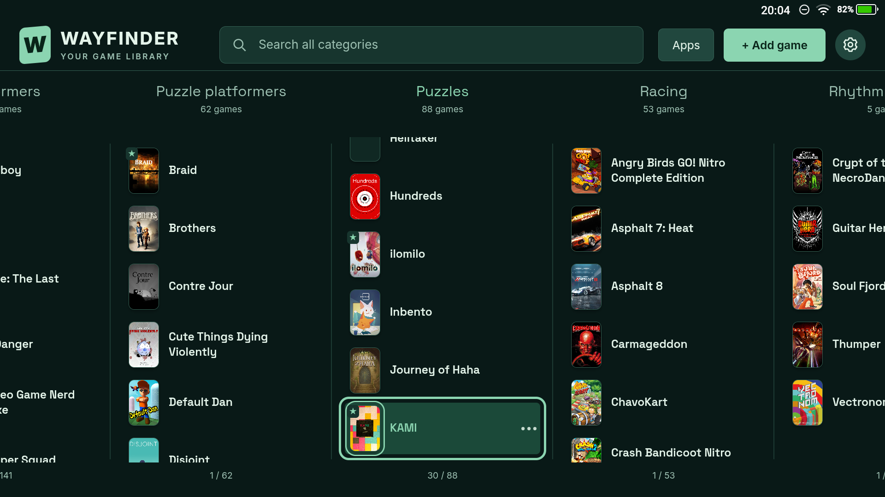

## Venice

**Fan Favorite** — warm Terracotta colors and a fan of adventure covers surrounding The Silent Age.

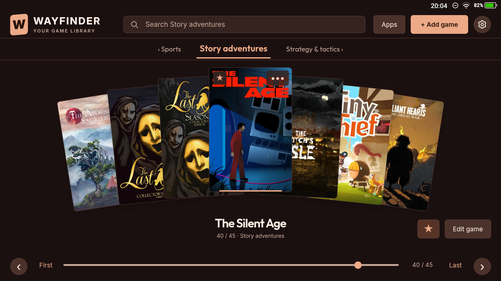

## Beyond the game library

Wayfinder also keeps everyday Android apps close at hand. News, Media, Social, Tools, and System sit above a favorites dock, with colorful controller hints along the bottom.

App icons shown use [Australis – Icon Pack by UNVOID](https://play.google.com/store/apps/details?id=com.unvoid.australis), available separately on Google Play. Section illustrations use [Phosphor Icons](https://phosphoricons.com/).

See the [README credits](../README.md#credits) for design inspirations, fonts, and bundled artwork.

[← Back to the README](../README.md)
