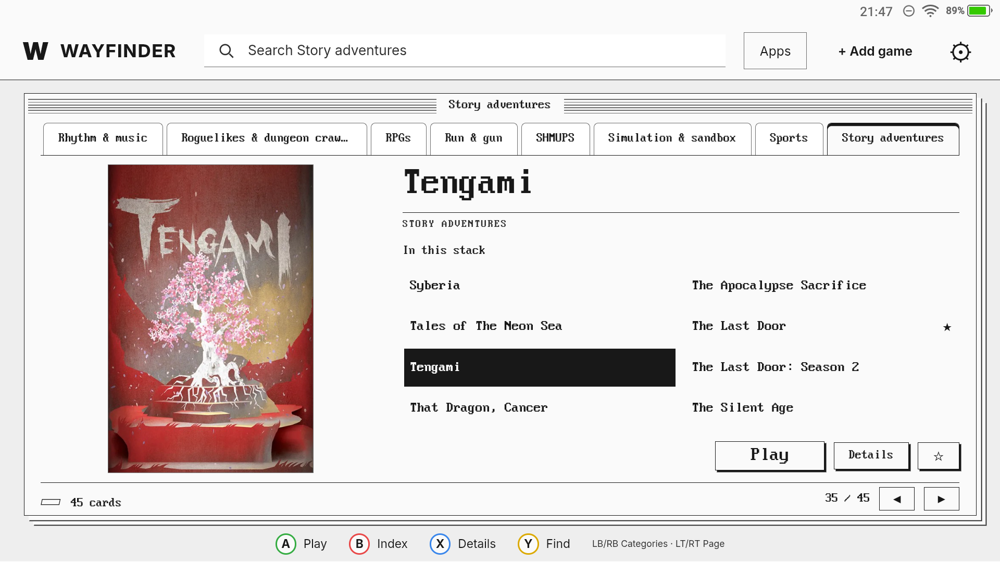
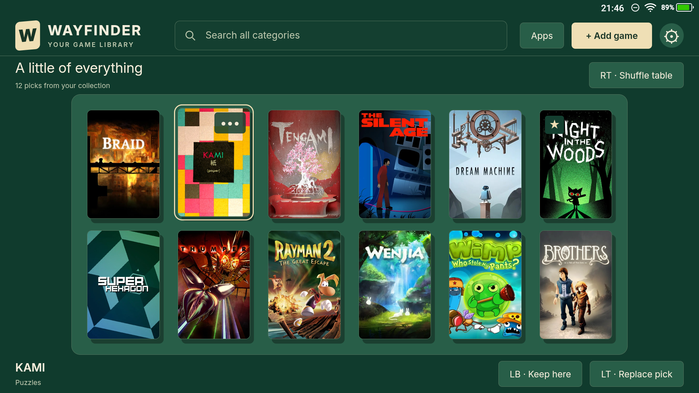
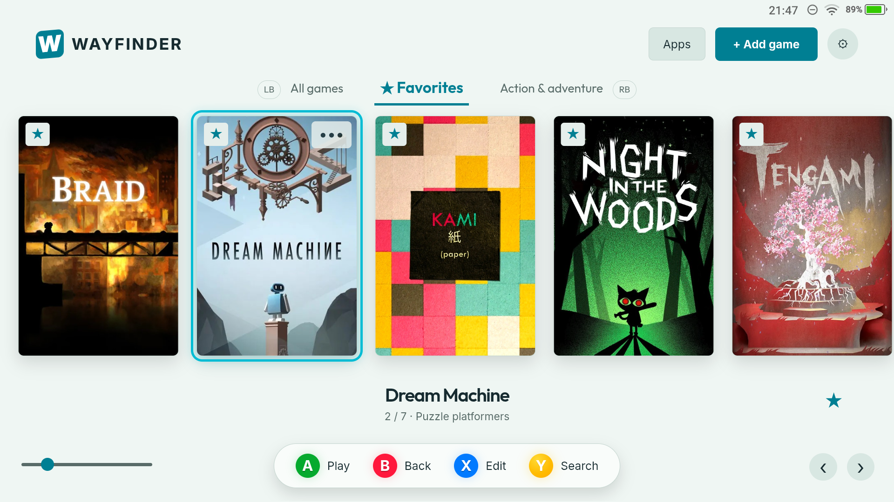
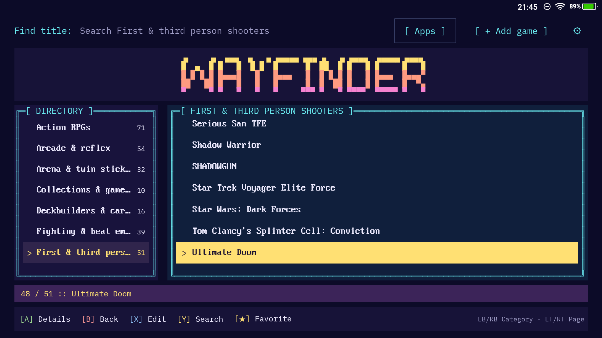
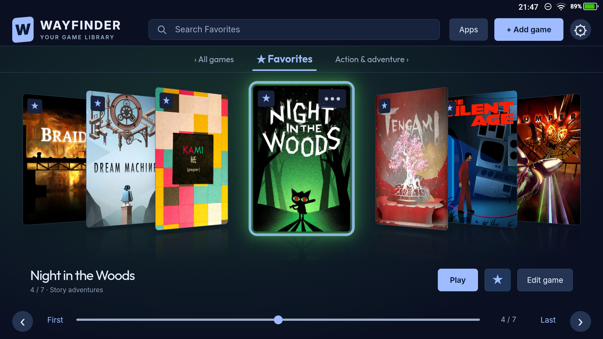
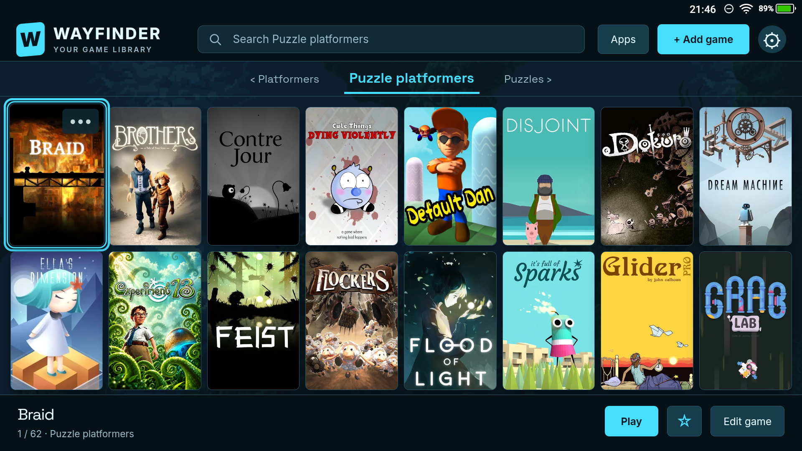
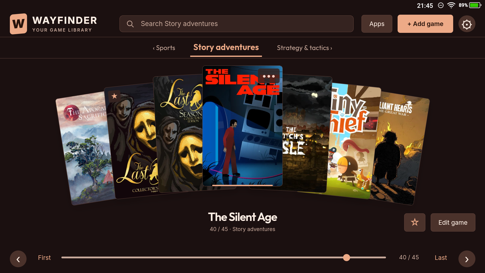
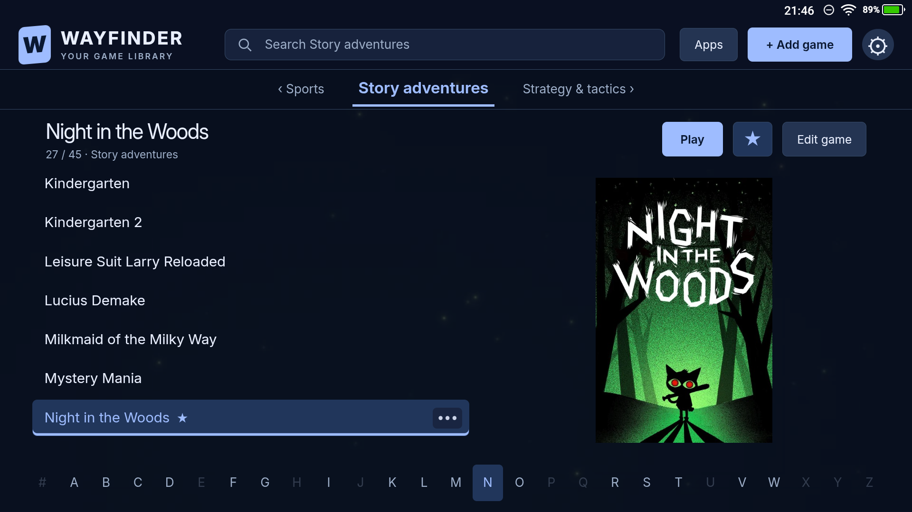
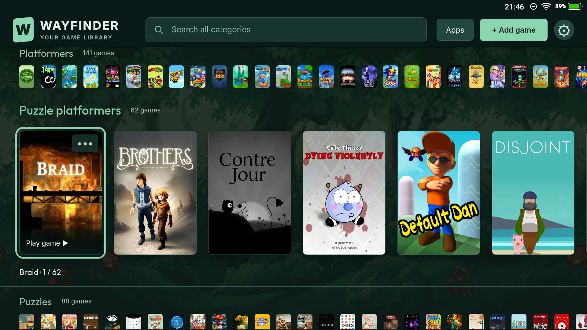
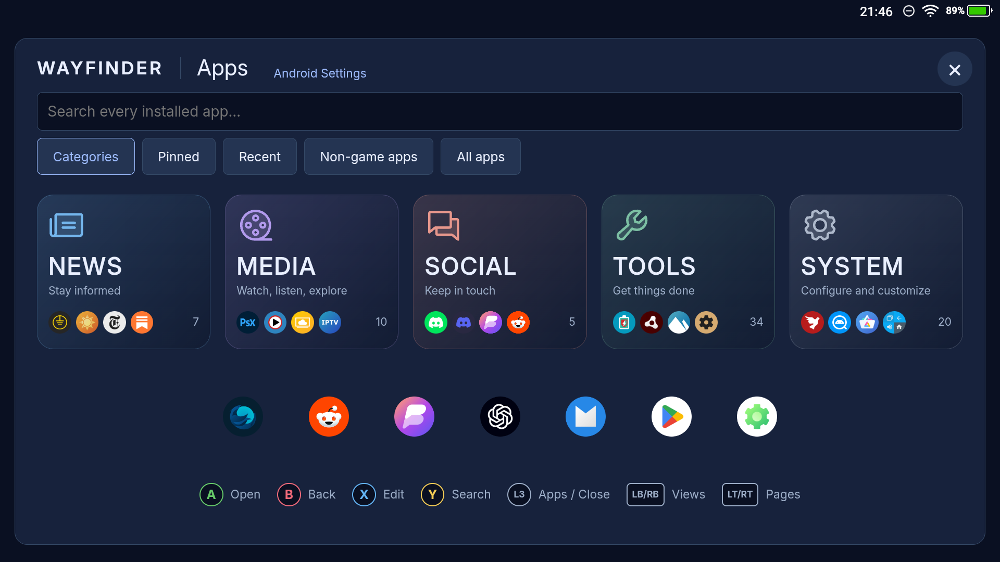

# Wayfinder screenshot gallery

[← Back to the README](../README.md)

Nine library views and a home for everyday apps. Start with Hyperstack’s classic card catalogue, then explore a different way to browse. The same collection can become a card table, a cover carousel, a quiet reading list, or a colorful BBS directory.

All ten images were captured directly on a **Pimax Portal at 1920 × 1080**, running **Wayfinder v0.9.191 Beta 15**, on **October 18, 2026**. These are unretouched screenshots. Appearance combinations, temporary favorites, and the Copenhagen table were arranged for the gallery; the device’s saved library and appearance were preserved. Games and personal cover artwork are not bundled. Animated backdrops appear as still frames.

[Palo Alto](#palo-alto) · [Copenhagen](#copenhagen) · [Kyoto](#kyoto) · [aBBotSford](#abbotsford) · [Cupertino](#cupertino) · [Berlin](#berlin) · [Venice](#venice) · [Oxford](#oxford) · [Vienna](#vienna)

[Beyond the game library: Apps](#beyond-the-game-library)

## Palo Alto

**Hyperstack** — the default for new installations. Category tabs, a paged title index, and portrait artwork form a classic card catalogue, with crisp Platinum colors and IBM VGA lettering.

## Copenhagen

**Full House** — a green felt table of twelve colorful covers. Keep a pick, replace it, or shuffle the table to rediscover something.

## Kyoto

**Smitchish** — a pale cover shelf with Dream Machine selected, soft shadows, and a floating dock of colorful controller hints.

## aBBotSford

**MyNameIsMUD** — ANSI Classic colors, IBM VGA lettering, and character-drawn windows. Ultimate Doom sits in a directory of shooters; opening a title’s details reveals its cover and launch controls.

## Cupertino

**Midnight favorites** — angled covers, subtle reflections, and artwork glow give Night in the Woods center stage.

## Berlin

**Room for a collection** — sixteen covers in two complete rows, with cyan accents and a subdued underwater backdrop.

## Venice

**Fan Favorite** — warm Terracotta colors and a fan of adventure covers surrounding The Silent Age.

## Oxford

**After Hours** — a clear title list, large selected artwork, an alphabetical index, and a faint scattering of fireflies.

## Vienna

**Woodland shelves** — an expanded shelf of puzzle platformers between compact previews of neighboring categories, over a forest backdrop.

## Beyond the game library

Wayfinder also keeps everyday Android apps close at hand. News, Media, Social, Tools, and System sit above a favorites dock, with colorful controller hints along the bottom.

App icons shown use [Australis – Icon Pack by UNVOID](https://play.google.com/store/apps/details?id=com.unvoid.australis), available separately on Google Play. Section illustrations use [Phosphor Icons](https://phosphoricons.com/).

[← Back to the README](../README.md)
