# Wayfinder screenshot gallery

[← Back to the README](../README.md)

One Android game library, nineteen ways to browse it, and a separate home for everyday apps. Each layout works with the same titles, categories, and portrait covers. Presets give those layouts a particular look; you can change the styling without reorganizing your games.

All 20 images are unretouched screenshots from **Wayfinder 0.9.233 Beta 20** on a **Pimax Portal (Snapdragon 865), Android 10, at 1920 × 1080**. The games, covers, and app icon pack shown belong to this device’s collection and are not bundled with Wayfinder.

[Indexes and desktops](#indexes-and-desktops) · [Shelves and cover walls](#shelves-and-cover-walls) · [Playful interfaces](#playful-interfaces) · [Everyday apps](#beyond-the-game-library)

## Indexes and desktops

### Palo Alto

**Hyperstack** — the default for new installations: a crisp card catalogue with category tabs, a paged title index, and Tengami’s portrait artwork.

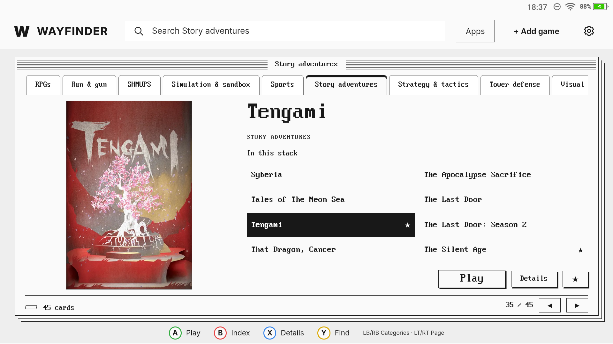

### Bath

**Field Notes** — warm paper, colored tabs, handwritten headings, and KAMI held in place with a strip of tape.

### Redmond

**Experience** — browse folders and a sortable game list, with the selected cover and launch information in a preview pane.

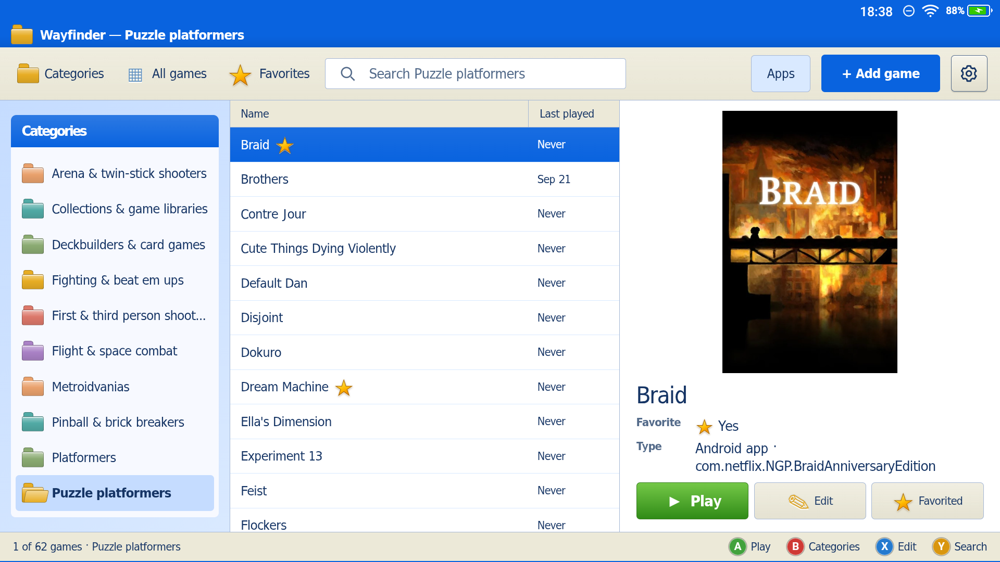

### Prague

**Cross Reference** — deep green colors and parallel category columns for browsing several parts of a collection at once.

### Atlantis

**Droplet** — cool blue desktop styling, colorful folders, and a large preview of Night in the Woods.

### Oxford

**After Hours** — browse a list of titles and give the selected game’s artwork its own space.

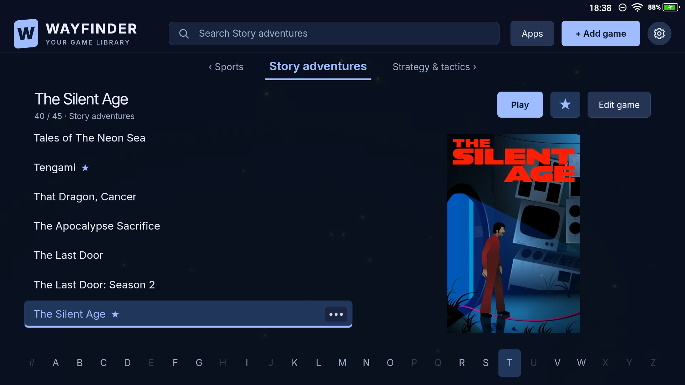

## Shelves and cover walls

### Tacoma

**Mixtape** — a shelf of favorite games with large portrait covers. Move between favorites, recent games, and a category directory.

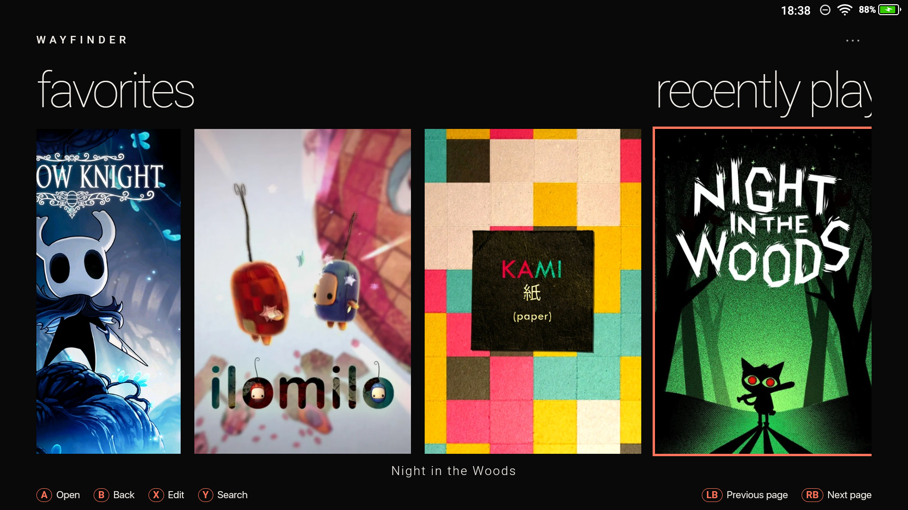

### Kyoto

**Smitchish** — a bright cover shelf, cyan selection glow, soft shadows, and a floating dock of colorful controller hints.

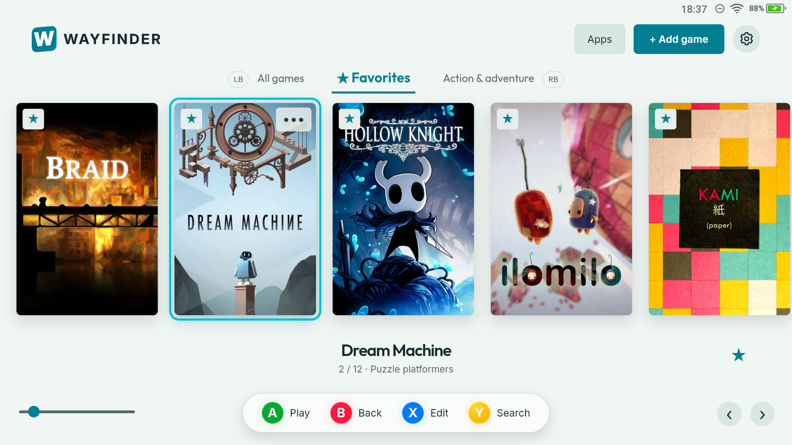

### Hong Kong: grid

**Dark grid** — scan a wall of portrait artwork under a strip of selectable categories. A custom variation of Cognate.

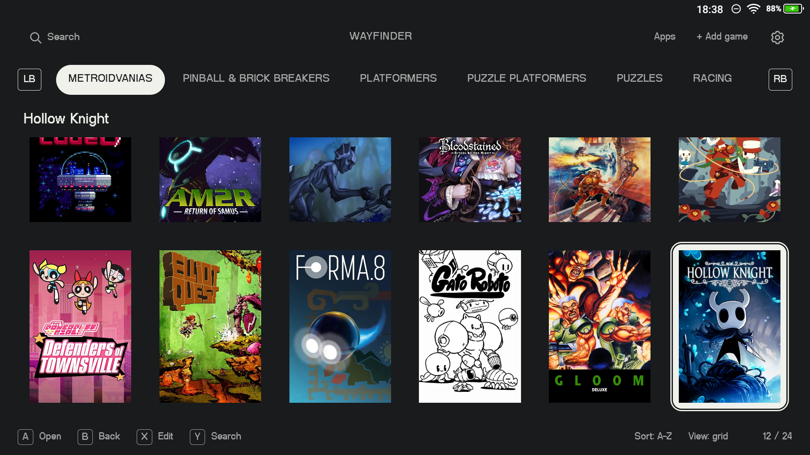

### Durango

**Boxer** — a dashboard with a recent-games sidebar for returning to something you played earlier.

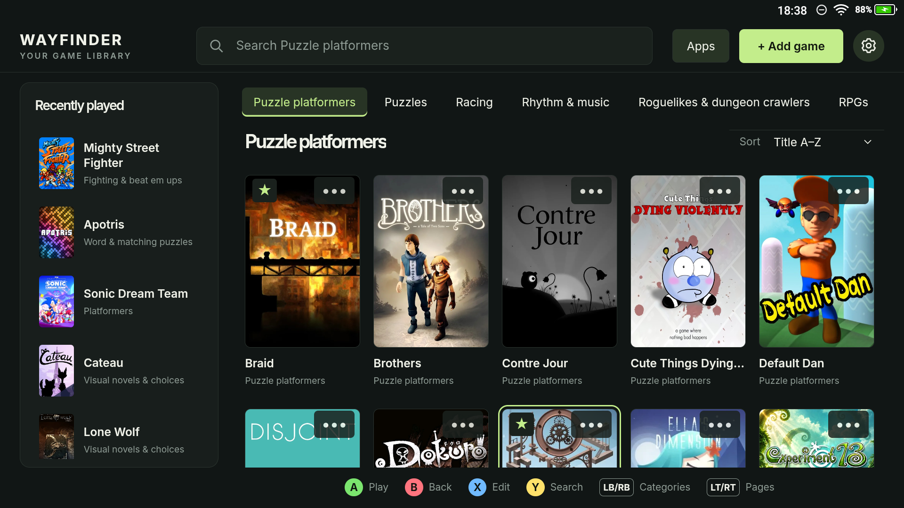

### Cupertino

**Midnight favorites** — a custom combination of Cupertino, Midnight colors, and artwork glow, with angled covers and reflections.

### Hong Kong: carousel

**Dark carousel** — equal-sized portrait cards and a fixed selection position, with the selected title, play history, and favorite status underneath. A custom variation of Cognate.

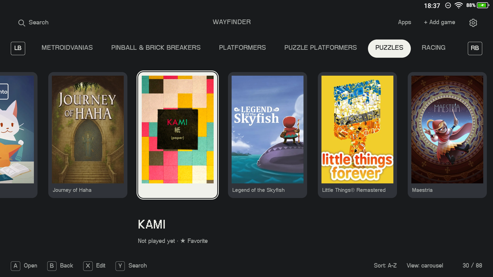

## Playful interfaces

### Copenhagen

**Full House** — twelve covers on a green card table. Keep a pick, replace it, or shuffle to rediscover something.

### Milan

**Homage** — bold orange graphics, oversized lettering, and a numbered title index give Sonic Mania Plus a packaging-inspired presentation.

### aBBotSford

**MyNameIsMUD** — ANSI colors, IBM VGA lettering, and character-drawn windows. Open a title’s details to see its cover.

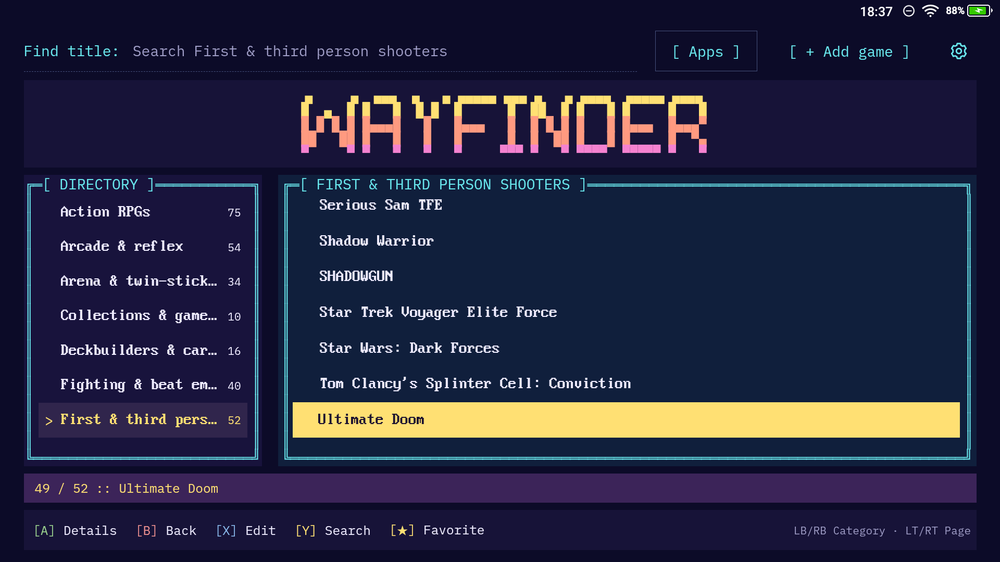

### Hong Kong: list

**Cognate** — a quiet light palette, capsule selection, and pixel lettering beside KAMI’s portrait cover.

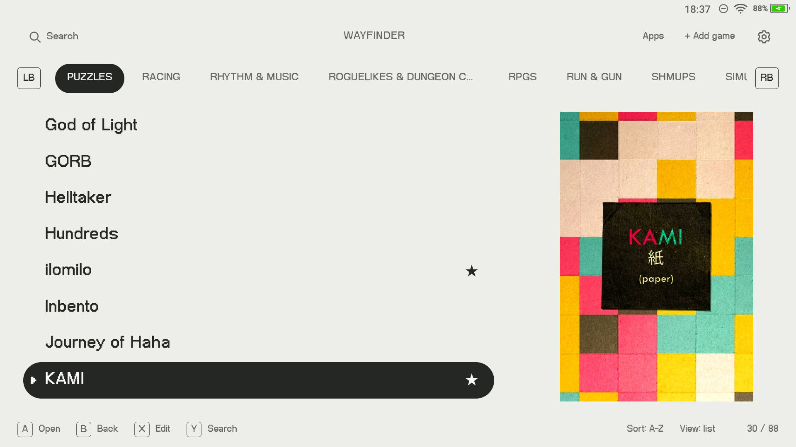

### Bellevue

**Blades** — curved metallic category panels frame a compact title list and Across Age 2’s cover.

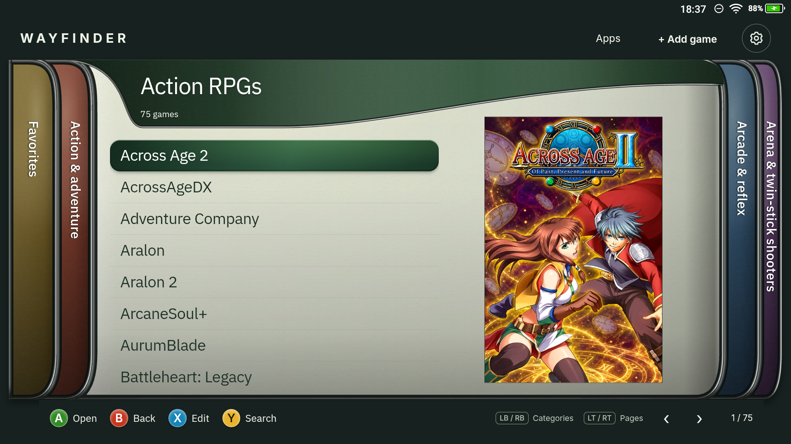

### San Francisco

**Final Frontier** — peach, lavender, and gold control panels surround a sci-fi library and Space Expedition.

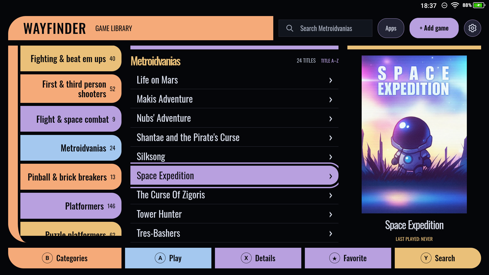

### Sedona

**Amped Up** — dark metallic panels, a green dot-matrix title display, and tactile player controls alongside Hollow Knight’s portrait cover.

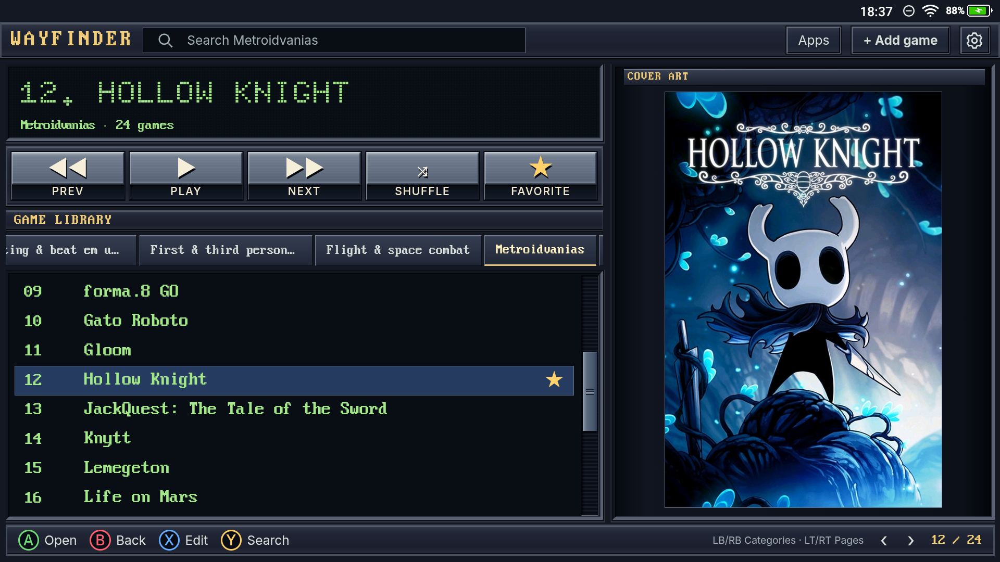

## Beyond the game library

Wayfinder also keeps everyday Android apps close at hand. News, Media, Social, Tools, and System sit above a favorites dock, with colorful controller hints along the bottom.

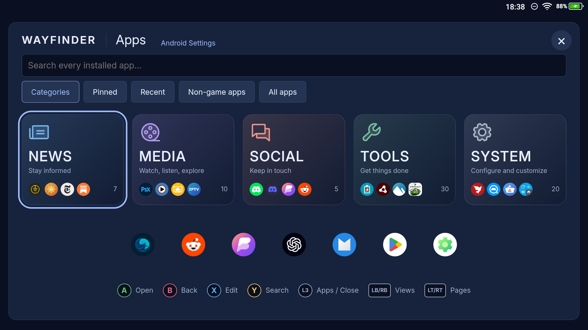

App icons shown use [Australis – Icon Pack by UNVOID](https://play.google.com/store/apps/details?id=com.unvoid.australis), available separately on Google Play. Section illustrations use [Phosphor Icons](https://phosphoricons.com/).

See the [README credits](../README.md#credits) for design inspirations, fonts, and bundled artwork.

[← Back to the README](../README.md)
